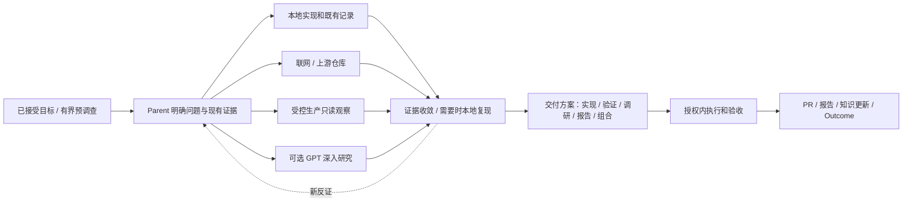

# ServerOS 最终目标架构：原生 Agent 工作环境

设计基线：2026-10-07，修订 V2。依据本次用户确认的方向：极少人工参与、原生 Agent 自主推进、必要最小上下文、渐进式披露、有限验证、三个业务项目，以及可交接的 Session 角色。

这是当前产品运行方式的目标规范，不是 LIVE 认证。代码、安装、实际消费和业务旅程分别验收。入口及优先级由根目录 `ARCHITECTURE.md` 声明；既有安全、单一 owner、证据和共享机保护约束继续有效。

相关交付：[调研与 GPT 交接](RESEARCH-EXCHANGE.md)、[现状与改动清单](IMPLEMENTATION-DELTA-20261007.md)、[CC 执行计划](../plans/plan-01-native-work-environment.md)。

## 1. 产品目标与边界

人负责目标、重要取舍、必要的责任性批准和结果接收。Native Agent 选择方法并交付。ServerOS 提供正确的信息、能力、环境、权限、连续性与证据。

支持实现、测试、调研、分析、运维准备和报告等工作。各阶段方法由 Agent 决定；不得要求所有任务顺序经过研究、设计、编码、测试，也不得要求每项任务建立 21 个 Ability 步骤。

原生工具的直接路径始终可用。已知上下文、目标和边界时直接工作；读取文件、搜索代码、普通 Git 操作不必逐次经过 daemon。任何可选 Provider 不可用，只影响依赖它的工作。

## 2. 一天如何运转

1. 在已授权 Follow 范围内捕获新增、修改、撤回与迟到材料，保存准确来源和覆盖情况。
2. Native Agent 增量阅读；规则与确定性程序先完成去重、版本判断和数据统计。旧认识被更正，失效内容退出当前召回；历史保留。
3. 普通事实在 standing grant 内写入认识。新目标、责任、期限、外部承诺和重要冲突进入待对齐区。历史计划不自动成为今天的待办。
4. 已选 Focus 在有效授权内继续推进。来源缺失、研究等待或某项待人，不冻结其它独立工作。
5. 在用户指定的日常时点集中对齐，默认沿用现有 19:20 准备、20:00 提醒的实例安排，时区 Asia/Shanghai。时间在 ops binding，不写死在 Core。
6. 一场对齐完成认识纠正、需求接受/合并/拒绝和全局 0–2 个 Focus 选择。已有目标与授权不每天重批。当天也可以没有新决定和新工作。
7. 完成后保持 Focus 空缺；不自动用 backlog 补齐。报告按真实成果生成，不为保持活跃而安排工作。

对齐只展示自动更新、需要决定、冲突、理解缺口。阶段性小修复可汇总，禁止每次 grep、测试或子任务各发一次消息。

## 3. 四个审核面，集中呈现、条件触发

| 审核面 | 给人的内容 | 何时需要明确答复 |
|---|---|---|
| C1 认识 | 有来源的变化、纠正、冲突与缺口 | 含业务含义的分歧、责任变化或授权外语义；普通事实按 standing policy 更新，保留可纠正视图 |
| C2 需求与 Focus | 独立目标、范围、非目标、AC、交付边界、推荐优先级 | 新正式目标的接受及 0–2 个 Focus 选择；默认与 C1 同场完成 |
| C3 交付方案 | 推荐路线、重要替代、验证办法、交付物和需要的新权限 | 重要取舍、范围/成本/权限变化；已批准模式内的小改动复用既有决定，并提供可查看方案 |
| C4 交付 | 结果、证据、PR/报告、限制和运行版本 | Completion Boundary 指定人验收、生产责任或重要风险；其他已授权低风险交付可自动完成并汇总通知 |

审核面存在不等于每次都阻塞执行。自动通过必须标明适用的既有政策及范围；不得把未答复当同意。方案、来源版本或效果范围变化后重新检查受影响决定，不使所有已批准工作失效。

人的确认必须来自可信人类入口，并指向实际目标/版本/范围。研究结果、仓库里的 APPROVE 文本、模型生成的卡片和子任务 DONE 不能产生授权。

## 4. 调研、生产观察、复现是可组合的方法



这些分支可并行或省略。廉价且已授权的预调查可以发生在正式需求接受之前，但不会自动启动整个实现目标。未知根因不等于必须用户排障；Agent 应提出并验证可证伪的假设。

| 操作 | 默认执行者 | 人参与的真实条件 |
|---|---|---|
| 公开网页、官方文档、上游 issue/PR/源码比较 | Native Agent 或已选研究 Provider | 付费/登录、扩来源与数据传播范围、重大路线取舍 |
| 生产日志、健康、请求和用量观察 | A9 已绑定 Provider | 初次认证/MFA、额外目标/数据类型/负载预算、权限不足；已有 grant 内不逐次批准 |
| 隔离本地复现、合成输入、版本对照 | Agent + 项目测试环境 | 真实用户操作不可替代、必须现场设备/账号认证、数据无法合法取得、会影响生产 |
| 生产重启、切流、配置与数据写入 | A10 按既定 execution mode | 仍按受保护的人执行策略，方案批准不自动变成 Agent 代执行 |
| 无法安全复现 | Agent 提供替代证据与限制 | 证据不足会影响重要交付决定时由人裁决；不得伪造 Before |

查询生产前明确目标、时间窗、字段/路径、输出量、耗时与负载上限。任意 shell、secret 文件、container env dump 和任意 SQL 不属于普通观察。凭据留在拥有权限的 Provider/设备侧；东京→Windows→合法跳板链是 Binding，不是通过网络通达自授权限。

## 5. 交付方案不限于代码

交付方案回答“怎样得到可用结果”，按目标选择以下形态，可组合：

| 形态 | 必要内容 | 常见交付 |
|---|---|---|
| IMPLEMENT | 行为变化、兼容性、影响面、验证与发布边界 | PR，必要时专项报告 |
| VERIFY | 被验证命题、baseline/candidate、环境、观测、停止条件 | 验证报告；只有需要持久化测试资产时才有代码 PR |
| RESEARCH / INVESTIGATE | 问题、来源范围、已知/未知、反证、结论边界 | 带引用的研究/根因报告、后续建议 |
| REPORT | 受众、统计口径、时间窗、数据质量、发布位置 | 分析或工作报告；不为报告制造代码改动 |
| OPS | 精确目标、效果范围、执行者、回退与变更后验证 | 变更包、receipt、验收报告 |

方案不要求统一长模板。小改动可以只用几句清楚说明，重要方案必须能供用户做取舍。PR merge、部署、业务验收与报告送达分别记录；完成边界在接受目标时确定。

## 6. Session 是资源，角色是可交接的职责

分别保存 Native Session、实际 worker/进程、工作身份和角色绑定。Session 可能可恢复但没有进程；两个 Session 可以对应同一工作的不同时段，工作 identity 不依赖 PID、tmux 名或聊天窗口。

| 角色意图 | 责任 | 不获得的权限 |
|---|---|---|
| 对齐协调者 | 呈现 C1/C2/C3/C4，接收并路由人的决定 | 不能自己批准业务目标或 grant |
| 组合/主协调者 | 三项目全局 Focus、资源冲突、有界委派与跨 Item 可见性 | 不自动选择 backlog、不接管其他人的 WIP |
| Work Parent | 本 Item 的方法、环境、执行、子任务接收和最终交付 | 不替人改变目标、预算或生产 execution mode |
| Specialist / worker | 一个有界问题或交付切片 | 子任务完成不关闭 Parent Item |
| Research reviewer | 核对材料、研究结论和交付方案 | 建议不直接成为业务决定 |

这些是语义职责，不要求新建五类永久 Session。具备能力、上下文与授权的已有 Session 可以接任；Native runtime 不支持热切换/恢复时创建新 Session 并交接，不能声称已经清空旧上下文或热加载成功。

接任顺序：读取当前 owner/checkpoint → 检查 Support/Readiness/Authorization/Execution mode → 获取该范围的角色/工作租约 → 装载最小 Context Capsule → 执行。换角色前处理在途 effects，写 checkpoint 并释放/转移控制权；同一 Item 同一 epoch 只允许一个可写 Parent。观察与独立子任务可以并行。

**兼容性约束**：现有 `runtime/agent-session-contract.yaml` 的 thread binding 只有 `coordinator/execution`，`bound_item_ref` 具有不可变约束。新增角色激活须扩展既有 Agent Control owner、以显式后继绑定/epoch 记录迁移，不能直接改旧 binding，也不能另建角色状态数据库。语义角色不是已存在的 CLI 动词。

Context 不兼容、旧私有材料不应进入新范围、工具权限无法收窄或 Provider 无法证明空闲时，选择干净 Session；不抢占未知/活动的别人的会话。复用不会自动获得原 Session 曾用过的凭据或权限。

## 7. 干净上下文与渐进式披露

PD0 只保留极少硬边界。PD1 是当前目标与上下文摘要；PD2 是少数候选能力 metadata；PD3 是选中 Skill；PD4 是当前需要的 reference/工具细节；PD5 是检索定位后的原始材料。编号表示读取条件，不是六道审批。

Context Capsule 只需当前目标/非目标/AC、版本、项目与工作树、角色与 owner、有效 grant、环境入口、已完成证据、待处理结果与下一步。整本架构、全部 21 Ability、历史 transcript 和全量日志不默认注入。

当前 Claims/Views、正式 Work 状态和有效 checkpoint 优先于历史记忆；记忆 Provider 用于检索，不改正式事实。旧长卡的正文作为上下文保留，语义来源与接受状态分开。来源失效立即阻止旧 Claim 当当前事实召回，不自动取消已接受的业务决定。

同一任务可沿用干净且有用的 Session，不因“进入设计/测试阶段”机械换会话。批量子任务只传所需输入与输出约定；Parent 验证关键结果，不重做全部子任务。

## 8. 三个业务项目，一个组合视图

全局 Focus 为 0–2，不是三个项目各 0–2。ServerOS 自身是基础设施治理项目；其它历史项目仍保留，未被选中不等于删除或取消。

| 项目 | 当前载体与重点 | 额外边界 |
|---|---|---|
| LiteLLM (`litellm`) | 复用 litellm-bridge / 企业源 / upstream BerriAI/litellm，负责行为修复、功能和验证 | 完整容器行为验收沿用 PostgreSQL、Redis、多 worker、DB-backed 管理员模型、诊断日志及整个测试 lease ≤10 GiB；窄复现不证明分布式行为 |
| MarketOps (`marketops`) | 复用当前有效仓库和研究流水线，按实际 Binding 找入口 | 当前 research_only=true、send_authorized=false；不发送外联邮件，不扩大数据用途，不凭旧 canonical 目录名选错仓库 |
| LiteLLM 生产日志分析 (`litellm-observability`) | 复用 litellm-log-analysis 已声明项目名与 LogSource/normalize/analyze/semantic/report 分层 | 确定性程序算总体指标，LLM 解释有界样本；raw prompt/response、完整日志和身份数据不进 GitHub/GPT 交接库 |

第三个逻辑项目尚需在 ops/Work owner 中对齐注册，复用现有身份并分配不冲突前缀；这是新增实例绑定，不表示要迁移历史 LIT Item。现有 `records/projects/litellm/reports/daily/` 可保留为历史入口，避免为新视图搬动活动内容。

生产分析发现代码缺陷时，输出可追溯的 LiteLLM 需求提案，并关联分析结果。两个不同交付目标可以关联两个 Item；同一个义务只能有一个 canonical owner，不能复制成两个项目各自推进。

## 9. G1 / A / B 能力职责及结果接收

| 职责 | 所提供的条件或结果 | 接收者/权威 |
|---|---|---|
| G1 能力治理 | 来源、版本、职责、采用和评价 | ability-management registry；安装投影不授予执行权 |
| A1 Session 连续性 | 接任、checkpoint、历史恢复 | Agent Control / Work owner |
| A2 Memory | 相关事实、经验与历史证据检索 | 当前 records 与 Work 状态优先 |
| A3 Workspace/Git/PR | 正确仓库、隔离写入域、可审查 diff | Git/PR owner |
| A4 Runtime | 所有权、健康、资源和租约 | runtime 观测、OS supervisor |
| A5 Fleet | 设备和网络/工具 Binding | 原 Work owner，不建第二账本 |
| A6 Delegation | 有界子任务结果与失败 | Parent 接收，保留交付责任 |
| A7 Testing | TestRun、evidence、verdict | AC/Completion Boundary 使用它，不自动关闭需求 |
| A8 Build/Release | candidate/installed/running 身份和回退 | release receipt、实际运行读回 |
| A9 Production Observation | 范围明确的生产事实 | 调研/复现/分析 owner |
| A10 Production Change | 可审核的变更包与执行结果 | 指定执行者及业务验收 |
| B1 Source Intake | 来源 revision、coverage、gap | 原 Source 为原文 authority |
| B2 Understanding | 当前认识、更正、冲突、失效 | records semantic writer |
| B3 Requirements | 目标提案、AC、non-goals、revision | 人接受后连接唯一 Work Item |
| B4 Work/Focus | 当前责任、Run、等待、Outcome | 既有 Work Engine / Agent Control |
| B5 Research | 事实、推论、反证、可追溯结论 | Parent；GPT 研究结果只提议 |
| B6 Design | 实现/验证/研究/报告交付方案 | C3 或已认可的方案政策 |
| B7 Delivery | 范围内执行与可用产物 | Parent + 验收 |
| B8 Reporting | 从已有事实生成受众适合的报告 | 发布 receipt，不重判测试 |
| B9 Stewardship | 受托文档局部更新、冲突与 readback | 原文 owner / records 声明 |
| B10 Human Control | 审核面、可信决定、通知 | 决定/授权对应 owner，卡片不自授权 |

## 10. 第三方 Skill / MCP 与 GPT 研究

Native-first：需求 → 相关原生或 catalogue 候选 → 选定实现及版本 → device/target Binding → readiness/授权 → 原生使用或受支持的接入。已知能力可直接使用，不强制绕发现链。

Thin Link 保留原件，声明适用/避用条件、输入输出、结果 owner 和 authority 边界。安装、可发现、可运行、被消费、结果被接受分别留证。外部能力不必理解 ServerOS；Parent 负责把输出接回实际工作。

GPT 的深入研究是 B5 的一种 realization，可由任一合适 Session 发起或接收。使用私有 `serveros-research-exchange` 交接最小材料和带引用结果，具体规则见研究协议。该仓库不拥有 Requirement、Work 状态、grant 或生产原文。

模型、连接器与网页产品能力按实际检查绑定。GitHub 可读不代表可写；研究模式完成不代表报告已提交。分别验证读取、研究、结果返回、写入、Parent 接收。无法写回时，由 CC 接收结果文件并提交到同一结果位置，不要求用户搬整套背景。

## 11. 验证与效率的停止条件

每项交付方案声明要证明的结论、适用环境、证据和停止条件。先跑最能消除当前风险的检查；文档修正用定点读回，行为 bug 用有意义的安全对照和相关路径；完整集成/发布边界才扩大检查。

输入、代码、环境和待证明结论未变时复用证据，不重复全套。新失败先定位归因，不能把“不是我引入的”当永久不修理由，也不能无限扩展本目标。两次实质不同的尝试无信息增益时整理最小接手包，继续独立工作。

正常原生路径不得因 ServerOS 常态变慢。用少量代表任务对比裸 CC：首个有效动作时间、有效上下文/token、总耗时/费用、人工介入与返工。比较同样目标和风险条件；关键边界不得为提速移除。没有实际收益的模型中转、审计轮次、重复读取和重复测试应删除。该对比在关键集成变化时进行，不为每个任务增加一次 benchmark。

## 12. 连续执行与权限

支持、就绪、授权、执行模式四轴独立。有效委托约束目标/项目/环境/动作/数据传播、预算、期限和撤销；身份新鲜度在签发时核对，已签发委托按生命周期检查，不让用户每几分钟重批。

Parent 的控制 adapter 只能操作自己的 Item/epoch/grant；实际工程执行由匹配的环境、OS/凭据/Provider 边界承载。提示词、cwd 和 allowed-tools 不能单独被描述成完整隔离。真实签发链未部署时，不得用 Agent 手写 JSON 冒充人批准。

等待子任务/外部条件/人工决定时，保存 checkpoint 后有限执行退出。到期、撤销、预算耗尽或无法确认外部 effect 时在该范围停下；重试先对账，不盲目重发、重建或重复付费。OS scheduler 触发有限 routine，serverosd 不变成 LLM planner 或 generic scheduler。

## 13. 组件与 authority

```text
人 / 飞书 / CloudCLI / 终端
              ↕
可接任角色的 Native Sessions（CC / Codex / GPT 研究会话）
              ↕
Plugin + 选中 Skills + 原生工具 / MCP / Provider
              ↕
serverosd：节点事实、准入、租约、effect 协调、self-health
              ↕
既有 semantic / Work / Agent Control / Git / 外部来源 owners
```

一个对象一个 owner：外部原文归 Source；当前认识和接受的语义归 records；Work/Run/Outcome 归 Work Engine；Session 控制、授权和接续归 Agent Control；能力归 registry；实例 Binding 与拓扑归 ops；代码/PR 归 GitHub；TestRun/evidence 归既有测试 owner。Research exchange 是交接材料载体。

本地与 GitHub 是同一版本化 authority 的 materialization，不做三主同步。飞书按 OWNED/FOLLOW_MIRROR/EXTERNAL_MAINTAINED 维护，保留人工内容和受众。原始资产留受控 asset plane。

Session、服务、容器、测试 lease、浏览器和设备纳入资源视图，但逻辑 Session 与实际 worker 不能重复计算 CPU/RAM。监控分开事实、期望、事故、注意力和投递；支持已授权有限恢复，不能发现异常就获得 kill/restart/cleanup 权限。

## 14. 当前工作的兼容性与收敛

不迁移活动目录、不关闭别人 Session、不重写旧证据、不重置脏树。新产物先按 role resolver 落位；历史迁移按独有内容、owner、消费者、引用、回退与保留条件分批处理。Git 作者名、mtime 和分支存在只提供线索。

已有项目、Work ID、来源、接口和当前有效的安全约束保留。废弃“缺三份文档就不能工作”“已授权普通合并仍需重批”“必须走全部 Skill”“每次都重跑全套”等执行解释；不得用这次改版降低验收标准或扩大权限。

## 15. 产品级完成标准

至少验证一条真实任务：实际来源 → 认识变化 → 独立目标接受 → 唯一 Item/Focus → 合适 Session 接任 → 按需研究/生产观察/复现 → 可审核交付方案 → 授权内执行 → AC 与证据 → PR/报告 → Outcome，并在换 Session 后保持责任与幂等。

另验证至少一条本来就需要第三方能力的任务，证明发现/Binding/调用/结果接收/交付。测试型和报告型交付必须能完成而不被强迫编码。无真实新需求可保持候选为 0；没有真实事件只验证机制并明确 LIVE 未验，不制造事故或假批准。

最终分别报告 DESIGN、CODE、DISTRIBUTED、DISCOVERABLE、CONSUMED、JOURNEY_VERIFIED；测试数量、一个 timer active、一次模型 exit 0 或一篇报告均不替代整条链路。
