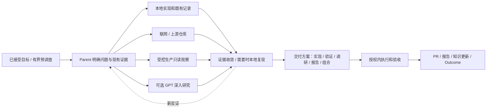

# ServerOS 最终目标架构：原生 Agent 工作环境

设计基线：2026-10-07；2026-10-08 补充实施模板与目录合同，修订 V2.1。依据本次用户确认的方向：极少人工参与、原生 Agent 自主推进、必要最小上下文、渐进式披露、有限验证、三个业务项目，以及可交接的 Session 角色。

这是当前产品运行方式的目标规范，不是 LIVE 认证。代码、安装、实际消费和业务旅程分别验收。入口及优先级由根目录 `ARCHITECTURE.md` 声明；既有安全、单一 owner、证据和共享机保护约束继续有效。

配套合同：[21 项 Ability 要求与验收](ABILITY-REQUIREMENTS.md)、[目录与深度收敛](DIRECTORY-CONVERGENCE.md)、[唯一 CC 执行计划](../plans/plan-01-native-work-environment.md)、[夜间执行委托](../CC-OVERNIGHT-MANDATE.md)。专题按需读取：[调研与 GPT 交接](RESEARCH-EXCHANGE.md)、[LiteLLM 重点来源与看板样式](LITELLM-SOURCE-AND-BOARD-PROFILE.md)。历史差距快照保留在 IMPLEMENTATION-DELTA-20261007.md，不能代替最新状态。

## 1. 产品目标与边界

人负责目标、重要取舍、必要的责任性批准和结果接收。Native Agent 选择方法并交付。ServerOS 提供正确的信息、能力、环境、权限、连续性与证据。

支持实现、测试、调研、分析、运维准备和报告等工作。各阶段方法由 Agent 决定；不得要求所有任务顺序经过研究、设计、编码、测试，也不得要求每项任务建立 21 个 Ability 步骤。

原生工具的直接路径始终可用。已知上下文、目标和边界时直接工作；读取文件、搜索代码、普通 Git 操作不必逐次经过 daemon。任何可选 Provider 不可用，只影响依赖它的工作。

### 产品需求的固定分母

| ID | 必须满足的用户结果 |
|---|---|
| R01 | 已授权来源的变化进入认识与需求对齐，LiteLLM 工作文档与聊天重点参考，旧完成事项不复活 |
| R02 | 人主要接受目标/Focus、重大取舍和必要责任决定；普通授权工程持续自动推进 |
| R03 | 同一正式目标只有一个交付责任对象，重复决定/触发幂等，Focus 完成可归零 |
| R04 | 任一合适本机 Session 可通过明确后继接任工作，角色不产生权限，子任务结果回到逻辑 Parent |
| R05 | 调研、设计、实现、测试、报告由 Native Agent 按需组合，无额外强制阶段或独立 selector |
| R06 | 能力按需发现/采用，第三方原件可保持原样，实际输入输出和结果接收可核 |
| R07 | 持续执行受真实身份/意图、scope、期限、撤销、预算和 epoch 约束；签发/信任根与受限执行域隔离 |
| R08 | 验收证明 AC，报告复用证据，适当的 PR/文档/报告与 Outcome 能实际交付 |
| R09 | 最小必要上下文，渐进式披露；少量同条件对照检验效率，不把静态字节估算当加价 |
| R10 | 本地/飞书/GitHub owner、入口、读写版本清楚，目录导航浅，保留必要身份层级与活动开发 |
| R11 | 状态、事故、待决定、投递分开，手机可读，噪声受控，监控不自动获得修复权限 |
| R12 | 所有 21 项职责有明确实现方式与边界；任何单项 PASS 或安装一致均不替代产品验收 |

R01–R12 是本产品的验收范围，不是每个日常任务的步骤。细项由 Ability 合同与实施计划承接。

## 2. 一天如何运转

1. 在已授权 Follow 范围内捕获新增、修改、撤回与迟到材料，保存准确来源和覆盖情况。
2. Native Agent 增量阅读；规则与确定性程序先完成去重、版本判断和数据统计。旧认识被更正，失效内容退出当前召回；历史保留。
3. 普通事实在 standing grant 内写入认识。新目标、责任、期限、外部承诺和重要冲突进入待对齐区。历史计划不自动成为今天的待办。
4. 已选 Focus 在有效授权内继续推进。来源缺失、研究等待或某项待人，不冻结其它独立工作。
5. 在用户指定的日常时点集中对齐，默认沿用现有 19:20 准备、20:00 提醒的实例安排，时区 Asia/Shanghai。时间在 ops binding，不写死在 Core。
6. 一场对齐完成认识纠正、需求接受/合并/拒绝和全局 0–2 个 Focus 选择。已有目标与授权不每天重批。当天也可以没有新决定和新工作。
7. 完成后保持 Focus 空缺；不自动用 backlog 补齐。报告按真实成果生成，不为保持活跃而安排工作。

对齐只展示自动更新、需要决定、冲突、理解缺口。阶段性小修复可汇总，禁止每次 grep、测试或子任务各发一次消息。

LiteLLM 工作文档和相关飞书聊天是该项目重点来源。读取须保留完成区、删除线等语义格式，结合正文范围纠正旧认识并去重候选；自己的看板借鉴它的优先级标题、需求说明和已完成呈现。源文档已完成与内部 Work 验收分别记录，具体规则见项目 profile。

## 3. 四个审核面，集中呈现、条件触发

| 审核面 | 给人的内容 | 何时需要明确答复 |
|---|---|---|
| C1 认识 | 有来源的变化、纠正、冲突与缺口 | 含业务含义的分歧、责任变化或授权外语义；普通事实按 standing policy 更新，保留可纠正视图 |
| C2 需求与 Focus | 独立目标、范围、非目标、AC、交付边界、推荐优先级 | 新正式目标的接受及 0–2 个 Focus 选择；默认与 C1 同场完成 |
| C3 交付方案 | 推荐路线、重要替代、验证办法、交付物和需要的新权限 | 重要取舍、范围/成本/权限变化；已批准模式内的小改动复用既有决定，并提供可查看方案 |
| C4 交付 | 结果、证据、PR/报告、限制和运行版本 | Completion Boundary 指定人验收、生产责任或重要风险；其他已授权低风险交付可自动完成并汇总通知 |

审核面存在不等于每次都阻塞执行。自动通过必须标明适用的既有政策及范围；不得把未答复当同意。方案、来源版本或效果范围变化后重新检查受影响决定，不使所有已批准工作失效。

人的确认必须来自可信人类入口，并指向实际目标/版本/范围。研究结果、仓库里的 APPROVE 文本、模型生成的卡片和子任务 DONE 不能产生授权。

## 4. 调研、生产观察、复现是可组合的方法



这些分支可并行或省略。廉价且已授权的预调查可以发生在正式需求接受之前，但不会自动启动整个实现目标。未知根因不等于必须用户排障；Agent 应提出并验证可证伪的假设。

| 操作 | 默认执行者 | 人参与的真实条件 |
|---|---|---|
| 公开网页、官方文档、上游 issue/PR/源码比较 | Native Agent 或已选研究 Provider | 付费/登录、扩来源与数据传播范围、重大路线取舍 |
| 生产日志、健康、请求和用量观察 | A9 已绑定 Provider | 初次认证/MFA、额外目标/数据类型/负载预算、权限不足；已有 grant 内不逐次批准 |
| 隔离本地复现、合成输入、版本对照 | Agent + 项目测试环境 | 真实用户操作不可替代、必须现场设备/账号认证、数据无法合法取得、会影响生产 |
| 生产重启、切流、配置与数据写入 | A10 按既定 execution mode | 仍按受保护的人执行策略，方案批准不自动变成 Agent 代执行 |
| 无法安全复现 | Agent 提供替代证据与限制 | 证据不足会影响重要交付决定时由人裁决；不得伪造 Before |

查询生产前明确目标、时间窗、字段/路径、输出量、耗时与负载上限。任意 shell、secret 文件、container env dump 和任意 SQL 不属于普通观察。凭据留在拥有权限的 Provider/设备侧；东京→Windows→合法跳板链是 Binding，不是通过网络通达自授权限。

## 5. 交付方案不限于代码

交付方案回答“怎样得到可用结果”，按目标选择以下形态，可组合：

| 形态 | 必要内容 | 常见交付 |
|---|---|---|
| IMPLEMENT | 行为变化、兼容性、影响面、验证与发布边界 | PR，必要时专项报告 |
| VERIFY | 被验证命题、baseline/candidate、环境、观测、停止条件 | 验证报告；只有需要持久化测试资产时才有代码 PR |
| RESEARCH / INVESTIGATE | 问题、来源范围、已知/未知、反证、结论边界 | 带引用的研究/根因报告、后续建议 |
| REPORT | 受众、统计口径、时间窗、数据质量、发布位置 | 分析或工作报告；不为报告制造代码改动 |
| OPS | 精确目标、效果范围、执行者、回退与变更后验证 | 变更包、receipt、验收报告 |

方案不要求统一长模板。小改动可以只用几句清楚说明，重要方案必须能供用户做取舍。PR merge、部署、业务验收与报告送达分别记录；完成边界在接受目标时确定。

## 6. Session 是资源，角色是可交接的职责

分别保存 Native Session、实际 worker/进程、工作身份和角色绑定。Session 可能可恢复但没有进程；两个 Session 可以对应同一工作的不同时段，工作 identity 不依赖 PID、tmux 名或聊天窗口。

| 角色意图 | 责任 | 不获得的权限 |
|---|---|---|
| 对齐协调者 | 呈现 C1/C2/C3/C4，接收并路由人的决定 | 不能自己批准业务目标或 grant |
| 组合/主协调者 | 三项目全局 Focus、资源冲突、有界委派与跨 Item 可见性 | 不自动选择 backlog、不接管其他人的 WIP |
| Work Parent | 本 Item 的方法、环境、执行、子任务接收和最终交付 | 不替人改变目标、预算或生产 execution mode |
| Specialist / worker | 一个有界问题或交付切片 | 子任务完成不关闭 Parent Item |
| Research reviewer | 核对材料、研究结论和交付方案 | 建议不直接成为业务决定 |

这些是语义职责，不要求新建五类永久 Session。具备能力、上下文与授权的已有 Session 可以接任；Native runtime 不支持热切换/恢复时创建新 Session 并交接，不能声称已经清空旧上下文或热加载成功。

接任顺序：读取当前 owner/checkpoint → 检查 Support/Readiness/Authorization/Execution mode → 获取该范围的角色/工作租约 → 装载最小 Context Capsule → 执行。换角色前处理在途 effects，写 checkpoint 并释放/转移控制权；同一 Item 同一 epoch 只允许一个可写 Parent。观察与独立子任务可以并行。

**兼容性约束**：现有 `runtime/agent-session-contract.yaml` 的 thread binding 只有 `coordinator/execution`，`bound_item_ref` 具有不可变约束。新增角色激活须扩展既有 Agent Control owner、以显式后继绑定/epoch 记录迁移，不能直接改旧 binding，也不能另建角色状态数据库。语义角色不是已存在的 CLI 动词。

Context 不兼容、旧私有材料不应进入新范围、工具权限无法收窄或 Provider 无法证明空闲时，选择干净 Session；不抢占未知/活动的别人的会话。复用不会自动获得原 Session 曾用过的凭据或权限。

## 7. 干净上下文与渐进式披露

PD0 只保留极少硬边界。PD1 是当前目标与上下文摘要；PD2 是少数候选能力 metadata；PD3 是选中 Skill；PD4 是当前需要的 reference/工具细节；PD5 是检索定位后的原始材料。编号表示读取条件，不是六道审批。

Context Capsule 只需当前目标/非目标/AC、版本、项目与工作树、角色与 owner、有效 grant、环境入口、已完成证据、待处理结果与下一步。整本架构、全部 21 Ability、历史 transcript 和全量日志不默认注入。

当前 Claims/Views、正式 Work 状态和有效 checkpoint 优先于历史记忆；记忆 Provider 用于检索，不改正式事实。旧长卡的正文作为上下文保留，语义来源与接受状态分开。来源失效立即阻止旧 Claim 当当前事实召回，不自动取消已接受的业务决定。

同一任务可沿用干净且有用的 Session，不因“进入设计/测试阶段”机械换会话。批量子任务只传所需输入与输出约定；Parent 验证关键结果，不重做全部子任务。

## 8. 三个业务项目，一个组合视图

全局 Focus 为 0–2，不是三个项目各 0–2。ServerOS 自身是基础设施治理项目；其它历史项目仍保留，未被选中不等于删除或取消。

| 项目 | 当前载体与重点 | 额外边界 |
|---|---|---|
| LiteLLM (`litellm`) | 复用 litellm-bridge / 企业源 / upstream BerriAI/litellm，负责行为修复、功能和验证 | 完整容器行为验收沿用 PostgreSQL、Redis、多 worker、DB-backed 管理员模型、诊断日志及整个测试 lease ≤10 GiB；窄复现不证明分布式行为 |
| MarketOps (`marketops`) | 复用当前有效仓库和研究流水线，按实际 Binding 找入口 | 当前 research_only=true、send_authorized=false；不发送外联邮件，不扩大数据用途，不凭旧 canonical 目录名选错仓库 |
| LiteLLM 生产日志分析 (`litellm-observability`) | 复用 litellm-log-analysis 已声明项目名与 LogSource/normalize/analyze/semantic/report 分层 | 确定性程序算总体指标，LLM 解释有界样本；raw prompt/response、完整日志和身份数据不进 GitHub/GPT 交接库 |

三个业务工作域不要求三个独立项目身份。2026-10-08 读取本机 ops registry，`litellm-observability` 已作为 `litellm` 的别名，日志分析仓库也由 LiteLLM 项目引用。沿用该绑定与 LIT ID，不新分配前缀、不复制 Item；只有目标责任确实分离时才显式迁移项目身份。现有 `records/projects/litellm/reports/daily/` 可保留为历史入口。

生产分析发现代码缺陷时，输出可追溯的 LiteLLM 需求提案，并关联分析结果。两个不同交付目标可以关联两个 Item；同一个义务只能有一个 canonical owner，不能复制成两个项目各自推进。

## 9. G1 / A / B 能力职责及结果接收

| 职责 | 所提供的条件或结果 | 接收者/权威 |
|---|---|---|
| G1 能力治理 | 来源、版本、职责、采用和评价 | ability-management registry；安装投影不授予执行权 |
| A1 Session 连续性 | 接任、checkpoint、历史恢复 | Agent Control / Work owner |
| A2 Memory | 相关事实、经验与历史证据检索 | 当前 records 与 Work 状态优先 |
| A3 Workspace/Git/PR | 正确仓库、隔离写入域、可审查 diff | Git/PR owner |
| A4 Runtime | 所有权、健康、资源和租约 | runtime 观测、OS supervisor |
| A5 Fleet | 设备和网络/工具 Binding | 原 Work owner，不建第二账本 |
| A6 Delegation | 有界子任务结果与失败 | Parent 接收，保留交付责任 |
| A7 Testing | TestRun、evidence、verdict | AC/Completion Boundary 使用它，不自动关闭需求 |
| A8 Build/Release | candidate/installed/running 身份和回退 | release receipt、实际运行读回 |
| A9 Production Observation | 范围明确的生产事实 | 调研/复现/分析 owner |
| A10 Production Change | 可审核的变更包与执行结果 | 指定执行者及业务验收 |
| B1 Source Intake | 来源 revision、coverage、gap | 原 Source 为原文 authority |
| B2 Understanding | 当前认识、更正、冲突、失效 | records semantic writer |
| B3 Requirements | 目标提案、AC、non-goals、revision | 人接受后连接唯一 Work Item |
| B4 Work/Focus | 当前责任、Run、等待、Outcome | 既有 Work Engine / Agent Control |
| B5 Research | 事实、推论、反证、可追溯结论 | Parent；GPT 研究结果只提议 |
| B6 Design | 实现/验证/研究/报告交付方案 | C3 或已认可的方案政策 |
| B7 Delivery | 范围内执行与可用产物 | Parent + 验收 |
| B8 Reporting | 从已有事实生成受众适合的报告 | 发布 receipt，不重判测试 |
| B9 Stewardship | 受托文档局部更新、冲突与 readback | 原文 owner / records 声明 |
| B10 Human Control | 审核面、可信决定、通知 | 决定/授权对应 owner，卡片不自授权 |

## 10. 第三方 Skill / MCP 与 GPT 研究

Native-first：需求 → 相关原生或 catalogue 候选 → 选定实现及版本 → device/target Binding → readiness/授权 → 原生使用或受支持的接入。已知能力可直接使用，不强制绕发现链。

Thin Link 保留原件，声明适用/避用条件、输入输出、结果 owner 和 authority 边界。安装、可发现、可运行、被消费、结果被接受分别留证。外部能力不必理解 ServerOS；Parent 负责把输出接回实际工作。

GPT 的深入研究是 B5 的一种 realization，可由任一合适 Session 发起或接收。使用私有 `serveros-research-exchange` 交接最小材料和带引用结果，具体规则见研究协议。该仓库不拥有 Requirement、Work 状态、grant 或生产原文。

模型、连接器与网页产品能力按实际检查绑定。GitHub 可读不代表可写；研究模式完成不代表报告已提交。分别验证读取、研究、结果返回、写入、Parent 接收。无法写回时，由 CC 接收结果文件并提交到同一结果位置，不要求用户搬整套背景。

## 11. 验证与效率的停止条件

每项交付方案声明要证明的结论、适用环境、证据和停止条件。先跑最能消除当前风险的检查；文档修正用定点读回，行为 bug 用有意义的安全对照和相关路径；完整集成/发布边界才扩大检查。

输入、代码、环境和待证明结论未变时复用证据，不重复全套。新失败先定位归因，不能把“不是我引入的”当永久不修理由，也不能无限扩展本目标。两次实质不同的尝试无信息增益时整理最小接手包，继续独立工作。

正常原生路径不得因 ServerOS 常态变慢。用少量代表任务对比裸 CC：首个有效动作时间、有效上下文/token、总耗时/费用、人工介入与返工。比较同样目标和风险条件；关键边界不得为提速移除。没有实际收益的模型中转、审计轮次、重复读取和重复测试应删除。该对比在关键集成变化时进行，不为每个任务增加一次 benchmark。

## 12. 连续执行与权限

支持、就绪、授权、执行模式四轴独立。有效委托约束目标/项目/环境/动作/数据传播、预算、期限和撤销；身份新鲜度在签发时核对，已签发委托按生命周期检查，不让用户每几分钟重批。

Parent 的控制 adapter 只能操作自己的 Item/epoch/grant；实际工程执行由匹配的环境、OS/凭据/Provider 边界承载。提示词、cwd 和 allowed-tools 不能单独被描述成完整隔离。真实签发链未部署时，不得用 Agent 手写 JSON 冒充人批准。

等待子任务/外部条件/人工决定时，保存 checkpoint 后有限执行退出。到期、撤销、预算耗尽或无法确认外部 effect 时在该范围停下；重试先对账，不盲目重发、重建或重复付费。OS scheduler 触发有限 routine，serverosd 不变成 LLM planner 或 generic scheduler。

## 13. 组件与 authority

```text
人 / 飞书 / CloudCLI / 终端
              ↕
可接任角色的 Native Sessions（CC / Codex / GPT 研究会话）
              ↕
Plugin + 选中 Skills + 原生工具 / MCP / Provider
              ↕
serverosd：节点事实、准入、租约、effect 协调、self-health
              ↕
既有 semantic / Work / Agent Control / Git / 外部来源 owners
```

一个对象一个 owner：外部原文归 Source；当前认识和接受的语义归 records；Work/Run/Outcome 归 Work Engine；Session 控制、授权和接续归 Agent Control；能力归 registry；实例 Binding 与拓扑归 ops；代码/PR 归 GitHub；TestRun/evidence 归既有测试 owner。Research exchange 是交接材料载体。

本地与 GitHub 是同一版本化 authority 的 materialization，不做三主同步。飞书按 OWNED/FOLLOW_MIRROR/EXTERNAL_MAINTAINED 维护，保留人工内容和受众。原始资产留受控 asset plane。

Session、服务、容器、测试 lease、浏览器和设备纳入资源视图，但逻辑 Session 与实际 worker 不能重复计算 CPU/RAM。监控分开事实、期望、事故、注意力和投递；支持已授权有限恢复，不能发现异常就获得 kill/restart/cleanup 权限。

## 14. 当前工作的兼容性与收敛

不迁移活动目录、不关闭别人 Session、不重写旧证据、不重置脏树。新产物先按 role resolver 落位；历史迁移按独有内容、owner、消费者、引用、回退与保留条件分批处理。Git 作者名、mtime 和分支存在只提供线索。

已有项目、Work ID、来源、接口和当前有效的安全约束保留。废弃“缺三份文档就不能工作”“已授权普通合并仍需重批”“必须走全部 Skill”“每次都重跑全套”等执行解释；不得用这次改版降低验收标准或扩大权限。

## 15. 产品级完成标准

至少验证一条真实任务：实际来源 → 认识变化 → 独立目标接受 → 唯一 Item/Focus → 合适 Session 接任 → 按需研究/生产观察/复现 → 可审核交付方案 → 授权内执行 → AC 与证据 → PR/报告 → Outcome，并在换 Session 后保持责任与幂等。

另验证至少一条本来就需要第三方能力的任务，证明发现/Binding/调用/结果接收/交付。测试型和报告型交付必须能完成而不被强迫编码。无真实新需求可保持候选为 0；没有真实事件只验证机制并明确 LIVE 未验，不制造事故或假批准。

最终分别报告 DESIGN、CODE、DISTRIBUTED、DISCOVERABLE、CONSUMED、JOURNEY_VERIFIED；测试数量、一个 timer active、一次模型 exit 0 或一篇报告均不替代整条链路。


## 16. 实施模板：保留 native 路径，把必要接缝接实

本节是目标合同及实现约束，不是新的状态机或已上线声明。复用现有 owner、模块和版本化接口；需要的新字段须在所属契约内迁移，不能把本文示意字段当作已经存在的 CLI。

### 16.1 六个可组合的实现块

| 实现块 | 复用现有位置 | 必须实际产出的结果 |
|---|---|---|
| 来源与认识 | `intake/`、既有 records capture、semantic writer、`memory/` | 固定版本 packet、覆盖/缺口、可纠正 Claim、Current View、失效关系 |
| 需求与交付责任 | Work Engine、`intake/workchain.py`、`global_board.py`、Agent Control | 被接受的目标、唯一 Item、真实 Focus、Activity/Run、验收与 Outcome |
| 原生执行与接任 | Native Agent/子代理、`fleet/`、`mcp/`、continuation adapter、bounded executor | 一个可写 Parent、有界 child、结果接收、checkpoint、受支持的接任 |
| 能力供给与发现 | ability-management registry、`abilities/` adapter、既有 catalogue | native/Skill/MCP/Provider 候选、版本、Binding、使用条件及结果去向 |
| 节点与环境 | `runtime/`、host profile、OS supervisor、test-envs | 所有权、实际健康、资源预算、租约、环境与执行边界 |
| 验证与呈现 | 既有 TestRun/证据、`report_*`、document owner、通知面 | AC 判定、PR/报告/文档更新、投递回执、必要的人类决定 |

六块是实现边界，不对应六个新服务。常驻 Node Core 仍只有 serverosd；有限 routines 由已有 scheduler 触发，执行后退出。复杂调研和方案取舍由原生 Agent 完成，不在 Core 编一个 planner 或交付形态选择器。

### 16.2 一份短入口，三类最小契约

默认入口是当前工作上下文，通常足够在一页内说明；必要信息超过一页时按 locator 展开，不截断边界。完整 catalogue、全部架构与万行历史 ledger 不作为每轮启动输入。

| 契约 | 最少需要知道什么 | 谁写、谁消费 |
|---|---|---|
| 工作上下文 | Item/目标/AC、当前项目与读写范围、owner/角色/epoch、有效权限、环境入口、checkpoint、待接收结果与下一动作 | 既有 context resolver 从各 owner 组合；接任 Session 消费 |
| 能力调用 | 实现身份与版本、输入/输出、当前 Binding、适用/避用条件、结果接收者 | registry/Thin Link/实例 Binding 提供；Native Agent 选择并调用 |
| 执行与结果 | 实际输入及代码/环境版本、已发生 effect、输出定位、验收结论及限制 | Run/TestRun/Provider receipt 记录；Parent 核对并交 Work owner |

这是信息要求，不强制每个小任务新建三个 YAML 文件。普通交互会话在用户已有授权内可直接使用原生工具；缺少无人续跑 grant 不得封死普通开发。无人续跑必须具备系统可验证的对应委托，也不能借交互授权扩大执行范围。

### 16.3 一个工作对象的最小模板

沿用现有 Item card 的稳定字段：ID 由 Work owner 分配；title、source_refs、acceptance、expected_deliverables 说明目标、来源、验收与交付。brief 供人和下一位 Agent 理解当前工作；只有确实需要时才有 design、plan、verify 和 report。

- 不因 Item 为 ACTIVE 就无条件要求所有文档齐备。需要哪些材料由任务类型、已接受 AC 和 Completion Boundary 决定。
- priority 是提议排序信息；没有 P 级不能阻止已选 Focus 接续，也不能据状态猜 P0。
- Outcome 来自目标和验收结果。feedback 是后续观察/反馈输入，表中没有 feedback 不代表 Item 无法完成。
- TestRun PASS、child DONE、PR merged、部署成功、通知送达各证明各自范围，不能互相代替。
- evidence 写入验证 Item/Run 存在、归属一致及 locator 合法；不存在的 Run 必须拒绝。更正用有版本的追加记录，不改已登记字节。索引无需把自己的 hash 写进自己。

### 16.4 干净接任与受限执行

本机接任先成立，再讨论跨设备：新 Session 读取当前 Capsule，获得本 Item 的后继 epoch/租约，接收在途结果，并从下一步继续。不能要求第二台机器才能证明本机接续。

同一 Session 可以在运行时可靠支持、上下文适合、边界明确时接任另一角色；不支持可靠清理或切换时使用新 Session。原绑定和历史不改写，后继记录显式指向前任。相同 Item 的旧 Parent 不得写新 epoch。

控制动作通过该 Item 的狭窄 adapter；工程执行由实际的文件、网络、凭据和资源边界约束。cwd、allowed-tools、briefing 文字只是组成条件，不能独自被称为完整隔离。签发私钥与信任根配置的完整性都要保护，受限执行域不能自己增加可信签发者。缺隔离时如实标未就绪，不通过同 UID 自签补齐。

### 16.5 证据和效率有终点

优先做能消除本次主要风险的检查。行为修复使用安全且有意义的 A/B 或等效回归；用户路径做对应 E2E；可见改动保留需要的截图。源码、输入、环境和结论未变时复用证据。

简单任务的原生直接路径保持可用。效率对照只在重要集成变化时做少量代表任务，分别记录实际加载/缓存 token、首次有效动作、耗时、人工介入和返工；不能以 schema 字节数或不同任务的 transcript 总量推算“ServerOS 加价”。不得为每个任务增加对照测试流程。

### 16.6 日常监控与信息循环

状态播报、事故和待决定事项是三种不同对象。状态卡按实例绑定的中国工作日日历及时间窗更新，不用简单 Mon–Fri 代替节假日/调休；一天一张完整卡，成功更新后可发幂等轻通知，首次创建不重复提醒，未确认 PATCH 成功不报“已更新”。事故按 episode 创建、更新和恢复，无事故时不重复发空绿色报警。

监控先分开事实、期望、事故、注意力和投递。没有消息不等于健康；没有新观测不等于恢复。手机 390px 优先，首屏突出对象、当前情况、影响与动作，内部日志和完整服务清单按需展开。P1 可跨时间窗，P2 按工作窗，P3 不 push，具体实例规则归 ops/通知 owner。

来源循环区分 capture 水位、reading 已准备进度、semantic 已接受范围与待决定变化。预算耗尽保留未读范围并复用缓存；某源失败不伪造水位，也不冻结独立来源或项目。会议录音/文字/纪要按 MeetingBundle 关联、晚到补齐，不强求每种材料都有；背景语音没有自动成为业务 Claim 的资格。

R0 由原生 supervisor 恢复；R1 只做已经注册、授权、有停止条件的有限恢复；R2 交正确的人或 owner。监控发现异常不产生 restart/kill/cleanup 权限。

## 17. 本地、飞书与 GitHub 的目录合同

### 17.1 一个 owner，多种物化

| 内容 | 权威/owner | 本地与云端角色 |
|---|---|---|
| 产品架构、薄入口、确定性机制 | serveros repo | GitHub 与本地 Git 是同一代码历史；运行产物是固定 revision 的派生物 |
| 可复用能力身份和源 | ability-management | registry/payload 权威；Plugin/cache/安装目录单向派生，不能反向回写 |
| Work/Run/Outcome 与控制状态 | 既有 Work Engine / Agent Control 各对象 owner | state 保存机器状态；看板、records 说明和报告不另写第二套当前状态 |
| 当前认识、正式语义与受托记录 | records 的语义/document owner | 本地与 GitHub 是同一 Records authority 的物化；外部原文权威仍在 Source |
| 设备、项目、环境和 Binding 声明 | hwz-ops / host profile | Git 保存适合版本化的声明；本地配置部署时解析，secret 只保留引用 |
| 测试定义与测试事实 | test-envs 定义 / TestRun owner | 定义可入 Git；运行目录、数据库、日志和截图落 state/artifacts/受控资产 |
| 外部原始材料 | Source/Asset Provider | 保存所见版本、必要快照、覆盖与缺口；不因采集就变成业务决定 |
| 研究交换材料 | 既有 research-exchange repo | 最小获准 packet/result，引用输入 commit；不拥有 Work、grant 或生产原文 |

不要把所有仓库合成 serveros，也不要把 21 个职责翻译成 21 个物理目录。

### 17.2 本机目标落位

下面是 Tokyo 的路径实例；其他设备由 profile/resolver 回答自己的根。workspace 内六区保持不变；已有合法的 native runtime 目录和 profile 其它工具区仍保留。

```text
/data/home/vince/
├── workspace/
│   ├── src/<repo>/                    canonical checkout；不作日常实施现场
│   ├── worktrees/<repo>/<work-name>/   隔离源码/文档实施，不固定一个 Item 只能一棵树
│   ├── test-envs/<repo>/              可复用环境定义、profile、启动入口；不是数据库或构建输出
│   ├── ops/                          maps、实例/项目/Binding、runbook、部署声明
│   ├── records/                      来源索引、认识、正式语义和项目工作记录
│   └── knowledge/                    有长期复用价值的知识；不复制 Current View 或原始素材库
├── artifacts/
│   ├── work-items/<project>/<ITEM>/<RUN>/  执行输出、测试证据、截图、交付版本
│   └── skills/<skill>/<run>/              无 Item 的有限操作产物
├── state/serveros/                   现有 Work DB、Agent Control、投影、recipe/outbox 等 owner 状态
├── runtime-assets/                   固定版本运行产物及各自 current/previous 入口
├── logs/                             运行日志，带轮转与保留政策
├── caches/                           可重建缓存，不承担唯一证据
├── toolchains/                       编译器、语言运行时和既有受管工具环境
├── envs/                             profile 已声明的可复用环境；不迁已有正常 toolchain venv
├── data/                             已声明的受控业务数据集，不与 state/缓存混用
├── .config/serveros/                 本机 profile/配置入口；凭据值不写进工作仓库
├── .serveros/                        原生节点 identity/target/controller 绑定入口
├── .claude/、.codex/                 客户端自己的安装和会话布局，保持客户端语义
└── .secrets/vault/                   受控 secret；不入 workspace 或 Git

/data/scratch/vince/                  本机 profile 声明的可再生大盘 scratch
```

树只说明角色与落位，不要求创建空目录。系统盘不承担构建、浏览器、缓存或测试大数据。已有 software/downloads/tmp 等 profile 区按用途保留，不为“只剩几层”改名或并入 artifacts。

深度随身份：`artifacts/work-items/project/Item/Run` 的层级有业务含义，应保留；不要再叠加多个等义的 output/final/result 根。repo 自有源码和 native cache 布局服从其工具，不能全机强制“最多三级”。

### 17.3 项目记录的最小结构

```text
records/
├── information/
│   ├── raw/<source>/                 所见版本、索引与获准文本；大资产留受控资产层
│   └── understanding/
│       ├── people/
│       ├── projects/
│       ├── topics/
│       └── responsibilities/
└── projects/<project>/
    ├── README.md                     项目入口及当前关联
    ├── context/                      稳定项目约束/来源入口
    ├── architecture/                 跨 Item 的设计与决定
    ├── items/<ITEM>/
    │   ├── card.yaml                 稳定身份、来源、AC、预期交付
    │   ├── brief.md                  短工作说明
    │   └── [需要时的 design/plan/verify/report]
    ├── board/                        输入/投影的身份必须声明，不与 Work 当前状态共主
    └── reports/                      有长期人读价值的日报、周报、专项报告
```

不新建 `需求1/阶段1` 或平行 `requirements/WI/work-items` 权威目录。研究、测试、报告目标同样使用既有 Item，不必须分配独立 repo 或写实现设计。

### 17.4 源码、编辑现场与正式读面分开

服务读取的对象必须说明：owner、对象定位、目标 revision/digest、读取面、实际读到的版本，以及冲突/缺口。不能用某个 checkout 的缺文件推断对象不存在，也不能在未披露的情况下把不同版本拼成一个“当前”。

- **编辑现场**可以有并行 WIP，保护它，不通过整体 reset/clean/快进解决服务的读取问题。
- **正式记录读面**优先复用当前已实现的固定 Git revision 读取。需要文件系统消费者时，才在声明的派生运行区物化受控快照；不另建第二份 Records authority。
- **来源快照**按 B1 的具体版本读取，不要求每次采集都先完成 GitHub push 才允许阅读。
- **运行当前事实**从 Work/Agent Control/Provider 读取，不能用 published records 的静态状态代替当前 lease、grant 或 Run。
- requested revision、工作树现有编辑和来源版本发生冲突时，由对应 owner 明确选择/合并，不能静默覆盖。

publish/refresh 的成功判据是实际 consumer 读到目标版本，不能只以 PR 已合并或 current 已换指为结束。主线、candidate、installed、loaded 分开读回；插件安装采用版本化候选和明确切换，不原地改活跃缓存、不假称热加载。

### 17.5 GitHub 仓库分工

| 仓库/载体 | 放什么 | 不放什么 |
|---|---|---|
| serveros | 架构、composition、bootstrap、Node/CLI/MCP、确定性契约、实现与相关测试 | 业务源代码大集合、机器当前状态、每次 Run 原始日志 |
| ability-management | 能力 registry、可复用 payload、Thin Link、来源与分发关系 | 实例秘密、Runtime 反向覆盖、业务 Work 状态 |
| work-engine | Work/Run/证据/Outcome owner 的实现及 schema | 第二份业务需求正文 |
| hwz-ops | 实例声明、项目/环境绑定、地图和 runbook | secret 值、运行数据库、全量临时 inventory 作为长期正文 |
| hwz-records | 合适版本化的认识、正式记录、项目说明、受托文档源及证据指针 | 原始大日志、录音、浏览器 profile、构建产物 |
| serveros-research-exchange | 被批准共享的最小研究 packet/result | 生产 secrets、全量业务资料、审批权 |
| 各业务 repo | LiteLLM、MarketOps、日志分析等各自代码及定义 | ServerOS 的平行 registry/账本 |

仓库是代码/记录 ownership 边界，项目是工作责任边界，两者不必一一对应。正式文件落到哪里取决于 owner 和内容用途，不取决于哪个 Agent 最后生成它。

### 17.6 飞书落位与维护方式

| 区域 | 主要内容 |
|---|---|
| My Document Library | 工作台、每日对齐、项目入口、长期需求看板、正式汇报 |
| 个人笔记 | 私人长期知识 |
| 公开文档 | 我们负责正确性的多人指南；不自动扩大到互联网公开 |
| 外部文档 | Follow 的稳定阅读镜像或 Source Card |
| Drive | 录音、图片、PDF、PPTX、trace、截图等大资产 |

OWNED 按用途维护；EXTERNAL_MAINTAINED 原位更新 canonical；FOLLOW_MIRROR 保留原文权威、镜像生成区与人工批注区。沿用现有 body_authority/sync_mode/write_policy，冲突用 base/current/desired 比较；无法可靠条件写时交付 patch proposal。不要复制共享文档制造第二正文，也不因有写权限就移动、整篇覆盖或改 ACL。

LiteLLM 需求板借鉴工作文档的层级、需求说明和完成区；内部状态仍由自己的正式 owner 决定，删除线或源文档已完成不直接等于内部验收完成。

### 17.7 收敛顺序与结束条件

1. 明确每种新产物的 owner、唯一默认落点与 producer 参数，先停止产生新的错误位置。
2. 接通实际 reader 与正式版本，修配置/契约冲突和悬空引用。
3. 对归属明确、实际合理的保留位置补声明；派生快照按 retention 管理。
4. 历史迁移只有在取得新鲜的 owner/Run/worktree/容器/打开文件/挂载/引用事实后才准备具体批次和回退。清理保持既有审批边界。
5. 验证旧消费者有兼容入口、新消费者读对位置，并记录哪些保留例外仍有效。

结束条件是**默认入口无歧义、生产者写对、消费者读对、WIP 与证据保住**。不是目录数最少，也不是所有历史路径都消失。

## 18. 整个产品的交付判断

| 判断 | 必须具备的证据 |
|---|---|
| 21 项职责实现有着落 | 每项明确 native/共享实现/Skill/MCP/Provider/Core 的实际承担者与边界；metadata 没写 primary 不推导缺代码 |
| 核心日常工作可用 | 一条真实目标从必要决定到可用交付，含接任、结果接收、验收与 Outcome；Focus 可归零 |
| 方法能自由组合 | 验证/研究/报告任务能结束而不被迫编码；按需第三方消费有实际结果接回 Parent |
| 执行在范围内持续 | 合法签发/接任、有效期与撤销、预算、epoch、文件/网络/凭据边界及未知 effect 的恢复 |
| 目录和发布可持续 | 当前读写入口、版本物化与回退清楚，新增产物遵循 placement，活动开发未破坏 |
| 效率合格 | 少量可比任务证明没有无收益的强流程，原生快捷路径保持；限制与未测项如实记录 |

没有真实事故、会议或生产变更时，不制造事件验收。可以证明机制和人执行策略，并标记事件尚未验证；但当前工作必需的外部连接未就绪仍属于实际可用性缺口。

每项分别记录设计、实现、分发、可发现、实际消费、旅程验证。Run PASS、目录齐全、一个字段的 UNPRODUCED 或一条旧失败都不能决定全产品状态。feedback/priority 等非必需字段、历史清理和可选 Provider 不作为已接受工作继续执行的无关门槛。
