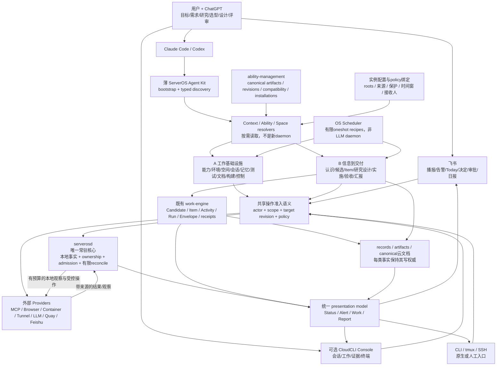

# ServerOS 系统图

> 本图是 [ARCHITECTURE](../../ARCHITECTURE.md) 的导航视图，不另立authority或额外必需服务。固定正文基线：`ef4386e21c2ed4be65ea9d538308c46925cba966`。



注意：图中的CloudCLI插件路径走共享语义；CloudCLI原生文件/Git/shell操作、用户直接SSH仍可能绕过ServerOS API。它们必须受native permissions/OS隔离/工作区scope约束，或标external/unmanaged，不能把图画成不存在的全局拦截器。

## 两个常见时序

```text
Agent执行：
目标 -> current Item capsule -> search(可跳过)
 -> inspect selected capability -> per-operation support
 -> fresh-enough readiness -> exact authorization
 -> load/attach -> bounded execution -> result/evidence -> checkpoint

日常工作：
授权源增量 -> relevance-filtered understanding -> Candidate Board
 -> 用户/ChatGPT选择与设计 -> Execution Envelope
 -> CC/Codex实施（可委派Quay）-> targeted verify
 -> 交付/决定/阻塞 -> 日报与知识更新
```

报告与卡片只是人类呈现，不回写为新的事实权威。图上一个方框不代表一个进程、repo、Skill或数据库。
