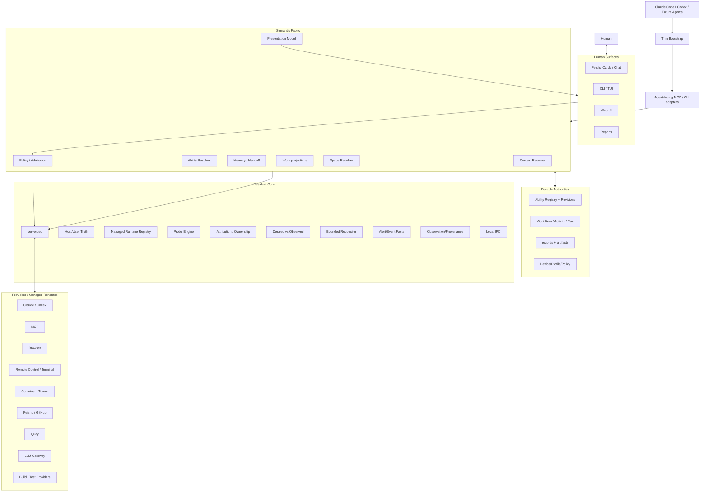

# ServerOS Architecture & Philosophy — Final Design Working Draft

> Status: **architecture working draft for discussion**, not yet the canonical replacement for `ARCHITECTURE.md`.
>
> Date: 2026-09-20
>
> Purpose: define the **ideal final ServerOS product** from first principles. This document intentionally describes the target architecture and product semantics rather than an implementation roadmap.

---

## 0. Executive decision

**ServerOS is a user-space Agent Operating Fabric.**

It is not a second operating system, not a workflow engine, not a monitoring suite, not an MCP registry, and not another agent framework above Claude Code or Codex.

Its job is to make the following questions cheap and trustworthy for an Agent:

1. **Where am I?**
2. **What work context am I in?**
3. **What can I do here, right now?**
4. **Through which concrete provider can I do it?**
5. **Is that provider actually ready now?**
6. **Am I authorized to perform this operation?**
7. **What does this work already remember?**
8. **What is the next useful action?**
9. **Where should the result and evidence go?**

The product should optimize for:

> **Strict truth, fast default path.**

The system must be honest about UNKNOWN, provenance, freshness and authorization, while avoiding the opposite failure mode: forcing agents through full scans, full probes, full test suites and governance rituals before ordinary work can proceed.

The final product shape is:

```text
one small resident core: serverosd

+ semantic kernels/resolvers
+ progressive Ability discovery
+ dynamic Desired Environment
+ durable Memory/Context
+ Information → Delivery work fabric
+ provider adapters
+ human control/presentation surfaces
```

---

# 1. Design philosophy

These principles are intended to remain stable even when implementations and providers change.

## 1. Small resident core

Exactly one resident core should exist by default:

```text
serverosd
```

Do not create `abilityd`, `memoryd`, `feishud`, `monitoringd`, `coordinationd` or other daemons merely because a semantic domain exists.

A semantic service is usually a resolver/schema/projection, not a process.

External processes are valid when they are **Providers or Managed Runtimes**, not when they duplicate ServerOS semantics.

## 2. Big installation, small active context

A machine may have many abilities installed.

An Agent session should see only a very small relevant subset.

```text
large catalogue
≠
large prompt
```

The normal path is:

```text
Thin Bootstrap
→ search
→ inspect
→ resolve
→ attach/load on demand
```

Progressive disclosure exists to reduce reading and context competition, not to force extra ritualistic API calls.

## 3. Truth and declaration are different things

```text
Documentation ≠ Declaration
Declaration   ≠ Observation
Observation   ≠ Authorization
```

A profile can say that a path should exist without proving it exists.

A registry can say a Provider is installed without proving it works.

A working Provider can still be unauthorized for a particular action.

## 4. UNKNOWN is a first-class answer

Never flatten:

```text
UNKNOWN
ABSENT
UNAVAILABLE
UNSUPPORTED
DENIED
NOT_APPLICABLE
```

into one generic failure.

They require different next actions.

## 5. Capability is resolved per operation

The useful resolution unit is:

```text
Ability#Operation
```

not only the whole Ability.

For example:

```text
document#read       SUPPORTED
document#restore    UNSUPPORTED
```

Support, readiness and authorization remain independent.

## 6. Safety is admission, not bureaucracy

Only actions that can materially change the world should pay the cost of admission.

Read-only discovery, inspection and reasoning should remain cheap.

Higher-risk or irreversible actions require increasingly fresh facts and stronger authorization.

## 7. Validation is proportional to semantic blast radius

The goal is:

> **minimum sufficient validation**, not maximum possible validation.

Do not run global scans and full regression suites for ordinary local edits.

Cache static proof by revision and reuse dynamic readiness while fresh.

## 8. Work continuity outranks topology neatness

Parallel active projects are workloads to protect, not directories to clean.

Workspace governance must never reset/clean/stash/move active or unknown-owner work merely to make topology aesthetically consistent.

## 9. One authority, many projections

Boards, maps, indexes, cards and summaries are projections.

They must not quietly become second databases.

```text
authority
→ projection
→ presentation
```

Never reverse this relationship.

## 10. Work Fabric is a funnel, not a document factory

Raw input does not automatically become a Work Item.

Candidate work is first surfaced on a board.

Only selected work is expanded into durable Item documentation.

```text
Input
→ Understanding
→ Candidate Board
→ SELECT
→ Item / Brief
→ Design / Plan
→ Execute
→ Verify
→ Report
```

## 11. Work recipes are not mandatory state machines

A simple fix may skip formal design.

A research task may have no implementation.

A test task may close with FAIL.

A complex feature may iterate between design, implementation and validation.

## 12. Human surfaces communicate; they do not become authority

Feishu, Web UI, CLI, terminal UI and future control surfaces carry facts and intent.

They do not redefine runtime truth, policy or work state merely because a user clicked a button.

## 13. The Agent should work, not serve the governance system

ServerOS succeeds when Claude Code/Codex get to useful work faster and with less context.

If ServerOS causes every small action to trigger catalogue rebuilds, global workspace scans, provider probes and thousands of tests, ServerOS has failed its own purpose.

---

# 2. Final serverosd core

## 2.1 Responsibilities that belong IN the daemon

`serverosd` owns local, machine-level, high-frequency facts and the bounded control loop.

```text
serverosd
├── Device / Host Identity
├── Host & User Resource Observation
├── Filesystem / quota / shm observations
├── Process / container / runtime observation
├── Managed Runtime Registry
├── Ownership / Attribution Graph
├── Probe Engine
├── Desired Runtime / Environment records
├── Runtime anomaly facts
├── Policy / Admission kernel
├── Bounded Reconciler
├── Event / Alert fact lifecycle
├── Observation / Provenance / Freshness
└── Local IPC
```

### Device/host truth

The daemon should know the stable ServerOS device identity and current machine facts.

Hostnames/IPs are routes or display metadata, not durable device identity.

### Resource observation

The daemon should directly own facts that otherwise tempt every renderer or Skill to shell out independently:

- CPU/load
- memory/swap
- per-user RSS/CPU estimate where possible
- filesystems
- quota
- inode usage
- `/dev/shm`
- process/runtime/container observations
- essential self-health

### Managed runtime registry

Managed runtime records should include:

- stable runtime identity
- kind/provider
- owner
- lifecycle
- desired state
- dependency pinning information
- declared probes
- protection/admission metadata

### Ownership/attribution

Ownership must be evidence-based.

Unknown ownership is a valid state and must normally result in DEFER rather than speculative cleanup.

### Four-axis runtime health

Runtime health should keep separate:

```text
liveness
transport
functional
readiness
```

A running process does not imply a usable capability.

### Desired vs observed environment

ServerOS should be able to join desired and observed runtime/environment facts, but not hard-code every possible resource type into core business logic.

### Admission

Admission answers whether a specific mutation is permitted in current context.

It consumes structured policy and fresh-enough facts.

It does not become a business workflow engine.

### Bounded reconcile

Automatic recovery is allowed only where:

- the desired state is explicit,
- ownership is known,
- the action is authorized,
- retry budget is bounded,
- and the resource is not protected by a higher-level rule.

Repeated failure escalates instead of looping forever.

### Events / alerts

The daemon owns alert facts and lifecycle identity, not final human wording.

A persistent condition should keep one stable identity rather than create a new “incident” every polling interval.

### Local IPC

`serverosctl` and Agent-facing adapters consume the same underlying semantics.

There should not be one truth path for humans and a different truth path for Agents.

---

## 2.2 Responsibilities that stay OUT of serverosd

The daemon should not own:

- Feishu API clients
- GitHub business workflows
- Quay task planning
- LLM planning
- long-term semantic memory generation
- full Ability catalogue contents
- Skill bodies
- document authoring
- Work Item state machines
- report generation
- cloud object placement
- Web/TUI product presentation logic
- full-text/vector retrieval indexes
- general-purpose schedulers for business work

These belong to Abilities, providers, resolvers, `work-engine`, durable records, or presentation layers.

---

# 3. Minimal object model

The architecture should use the smallest set of concepts that still prevents category errors.

## 3.1 Ability-side objects

### Ability

**WHAT can be done.**

Example:

```text
browser.automation
document.management
agent.session
```

### Operation

The concrete semantic verb.

Example:

```text
browser.automation#navigate
browser.automation#click
agent.session#resume
agent.session#interrupt
```

### Provider

**HOW the Ability is implemented.**

Examples:

- Playwright MCP
- Desktop Commander
- Docker
- Claude Code
- Codex App Server
- Feishu API
- Quay

### Binding

The concrete Provider instance on a concrete device or environment.

Example:

```text
Tokyo / playwright-mcp:1
Tokyo / shared-litellm-gateway
```

### Attachment

The current consumer relationship.

Example:

```text
Claude Session A attached to Tokyo Playwright Binding
```

Suggested scopes:

```text
session
work-item
project
device-persistent
external
```

### Revision

Pinned identity/version for managed ability/provider artifacts.

Revision is not necessarily part of every Agent-facing interaction, but it remains first-class in distribution, reproducibility and compatibility.

### Profile

Profile is slow-changing declarative configuration for a class of environment.

It is not runtime truth.

### Adapter

Adapter describes how a given Agent runtime consumes a Provider.

Claude and Codex can consume the same Ability through different adapters without creating different abilities.

---

## 3.2 The three independent axes

For every `Ability#Operation`:

### Support

```text
SUPPORTED
UNSUPPORTED
UNKNOWN
```

Question:

> Can this Provider semantically perform this operation?

### Readiness

```text
READY
DEGRADED
NOT_READY
UNKNOWN
```

Question:

> Can it perform it here and now?

### Authorization

```text
ALLOW
ASK
DENY
UNKNOWN
```

Question:

> May this caller perform it in this context?

No axis may substitute for another.

---

# 4. Observation model

Runtime facts should share a compact envelope.

```text
Observation
├── subject_ref
├── dimension
├── value/state
├── epistemic
├── confidence
├── observed_at
├── freshness
├── source
├── provenance
├── coverage
└── evidence_ref?   # only when useful
```

Recommended semantics:

```text
epistemic:
  FACT | INFERRED | UNKNOWN

confidence:
  AUTHORITATIVE | INFERRED | UNKNOWN

freshness:
  FRESH | STALE | EXPIRED | UNKNOWN
```

Evidence artifacts should not be mandatory for every low-risk observation.

The evidence system exists to support review, high-risk decisions and Work acceptance, not to turn every metric sample into paperwork.

---

# 5. Ability discovery and progressive disclosure

## 5.1 The Agent-facing experience

The final experience should be:

```text
Thin Bootstrap
    ↓
native Agent discovery + ServerOS advisory search
    ↓
Candidate Abilities
    ↓
Inspect
    ↓
Resolve Ability#Operation
    ↓
Reuse fresh readiness OR bounded active probe
    ↓
Authorization / Admission
    ↓
Attach / load only what is needed
    ↓
Execute
    ↓
Result / evidence
    ↓
Detach by scope/refcount
```

This is a capability chain, not a mandatory ceremony.

An Agent that already knows exactly which Ability it needs may skip search.

A read-only planning action may avoid active readiness probes.

A fresh readiness observation should be reused.

## 5.2 Thin Bootstrap contents

The bootstrap should contain only:

- current device identity/label
- current project
- current Item if any
- current Run if any
- a very short authority/admission reminder
- the existence of ServerOS search/inspect/resolve interfaces

It should not preload:

- full Ability catalogue
- full MCP schemas
- all Skills
- all machine status
- all memory
- all previous Work history

## 5.3 Search index

Start with a compact structured search index:

```text
ability id
title
short description
operations
domain/tags
provider kinds
runtime compatibility
risk class
source revision
keywords/aliases
```

Hybrid lexical + metadata retrieval should be the default.

A vector database is optional and should only be added if catalogue scale and measured retrieval quality justify it.

The retrieval result is advisory, not authority.

## 5.4 Search result size

Normal search should return a small candidate set.

Recommended product target:

```text
3–8 relevant abilities
```

The point is not to find exactly one answer. It is to shrink the candidate space enough that structured resolution can make the real decision.

## 5.5 Lazy body/schema loading

Load only when needed:

- Skill body after candidate selection
- Provider details after inspect
- MCP tool schemas after Provider selection/attachment
- expensive readiness probes only when execution requires them
- memory details only when current work needs them

---

# 6. Dynamic Desired Environment

The effective environment is:

```text
Desired Environment
+ Observed Environment
+ Ownership / Policy
+ Agent / Session / Work Context
=
Effective Environment
```

Examples of dynamically required resources:

- MCP server
- Browser
- Container
- Tunnel
- Test environment
- LLM gateway
- Remote control provider
- credential reference
- specialized local service

A requirement may be declared at these scopes:

```text
session
work-item
project
device-persistent
external
```

ServerOS should maintain references/leases rather than assuming every discovered runtime becomes permanent.

Example:

```text
Session requires MCP
→ desired ref_count +1
→ provider ready
→ attachment created

Session ends
→ ref_count -1
→ session-scoped provider may stop

Project-scoped provider
→ remains desired

Unrecognized new MCP
→ candidate only
→ ask: Session / Project / Persistent / External / Ignore
```

“Observed” must never silently become “Desired”.

---

# 7. Two Ability families

Ability families are **logical navigation domains**, not daemon boundaries and not necessarily repositories.

---

# Family A — Infrastructure / Agent Working Infrastructure

## A1. Ability & Composition Management

Owns:

- ability identity
- revisions
- compatibility
- distribution
- composition/packs
- search metadata
- install/reconcile state

Primary operations:

```text
search
inspect
resolve
compose
build
install
reconcile
```

Does not own live runtime truth.

---

## A2. Runtime & Resource Management

ServerOS core produces facts.

Ability procedure explains how an Agent should inspect/use those facts.

Owns:

- managed runtime procedure
- health interpretation
- lifecycle rules
- ownership-safe operations

Does not implement a second resource collector.

---

## A3. Workspace & Repository Management

Owns:

- repo/worktree/test-env placement
- workspace roles
- protection
- safe worktree acquisition
- topology drift proposal/reconciliation
- parallel-work protection

Primary principle:

> Protect active business work before making the workspace neat.

It must be device-neutral.

Machine-specific Tokyo rules should be data/policy/profile inputs, not hard-coded Skill semantics.

---

## A4. Live Agent Session Management

Owns the logical Agent session control contract:

```text
list
inspect
create
resume
send
interrupt
stop
handoff
```

Each operation has independent support/readiness.

A Session is not a PID, tmux pane or chat id.

Those are provider locators.

---

## A5. Session History / Memory / Handoff

Keep distinct from live control.

Owns:

- transcript/history discovery
- archive/restore where supported
- durable checkpoint
- handoff record
- recall/retrieval
- context restoration

Durable Memory authority lives in versioned records/evidence.

Retrieval indexes remain rebuildable projections.

---

## A6. Test Environment & Verification

Owns:

- reproducible test definitions
- test environment lease/reuse
- smoke checks
- targeted test selection
- evidence production
- teardown/release

Does not require rebuilding every test environment or running a full suite for every edit.

---

## A7. Build / Image / Artifact / Release

This should be a real independent Ability because it has distinct lifecycle, providers, artifacts and risk.

Owns:

```text
pinned inputs
→ build
→ digest/manifest
→ smoke
→ publish/promote
→ rollback identity
```

Typical providers:

- Docker / BuildKit
- package builders
- ServerOS deterministic builder
- artifact stores

Critical persistent runtime dependencies should not float silently.

---

## A8. Document Stewardship

A document lifecycle Ability should exist only if it remains clearly separate from content semantics and cloud placement.

Owns:

- canonical locator
- document identity
- revision/publication state
- superseded relationship
- broken link/reference detection
- publish lifecycle

Does not decide what the document means.

Does not own Feishu folder topology.

---

## A9. Engineering Change Discipline

Do **not** create dozens of micro Skills.

Small-change discipline should primarily be a shared engineering invariant plus a reusable recipe.

Core rule:

```text
understand goal
→ find smallest semantic closure
→ change only required surfaces
→ no opportunistic refactor
→ no opportunistic workspace cleanup
→ targeted validation proportional to risk
```

“Small change” is measured by semantic blast radius, not file count.

A schema change may legitimately touch generated files.

A two-file edit may still cross two authorities and therefore be large.

---

## A10. Node Policy / Compliance

Tokyo-specific operational policy should be **machine/profile policy data**, interpreted by admission and surfaced through Skills.

Do not make “Tokyo Rules” a standalone business Ability.

Examples:

```text
Tokyo = primary development node

ACTIVE / UNKNOWN / LEASED
→ PROTECT or DEFER

other actor WIP
→ no reset / clean / stash / move

destructive governance
→ proposal-only + fresh re-resolution

secret values
→ never Git/state/evidence

business continuity
→ outranks topology convergence
```

Natural-language instructions may explain policy, but structured admission rules are authoritative where actions are gated.

---

## A11. Environment Providers

These are Provider families rather than a single mega Ability:

- MCP
- Browser
- Remote control
- Container
- Tunnel/network endpoint
- LLM gateway
- credentials
- shell/terminal
- future providers

ServerOS should resolve and attach them dynamically.

---

## A12. Human Control

Owns the semantic human-control boundary:

- notification
- conversation targeting
- verified human identity
- bounded approval
- session/action selection
- event response

Feishu, Web UI, tmux UI or other surfaces are Providers/adapters.

The transport is not the policy authority.

---

## A13. Fleet / Device Coordination

Owns:

- durable device identity
- topology
- declared profiles
- cross-device bindings
- capability visibility across devices
- controlled handoff

Single-node operation remains a fully valid ServerOS configuration.

---

# Family B — Information → Delivery Work Fabric

## B1. Input Capture & Archive

Inputs:

- Feishu chat
- Feishu Docs/Wiki/Minutes
- GitHub
- external files
- explicit human input

Outputs:

- Source
- Observation
- Snapshot
- stable locator
- capture metadata

Archive and interpretation stay separate.

---

## B2. Structured Understanding

Transforms source-backed information into:

- facts
- claims
- constraints
- questions
- decisions
- contradictions
- current understanding

Agent inference does not automatically become high-confidence durable truth.

---

## B3. Candidate Work & Cross-project Board

Creates a personal view of possible work across projects.

Candidate is not yet Item.

Board is a projection, not a second state database.

The user should see:

- why it matters
- project
- source
- rough urgency/value
- uncertainty
- next useful decision

Then select today's 1–2 priorities.

---

## B4. Item / Brief

Only selected work becomes a durable Work Item.

The Item should carry:

- stable identity
- goal
- scope
- acceptance
- source links
- expected deliverables

A Work Item is not:

- a PR
- a worktree
- a test environment
- a Quay task
- a session

---

## B5. Requirements / Product Design / Technical Design

Complex work may expand into:

- requirement/product document
- technical architecture/design
- alternatives/tradeoffs
- impact/risk

Simple work can skip most of this.

Document depth follows risk and complexity.

---

## B6. Planning

Planning becomes explicit only when it adds value.

Complex execution may use an Activity DAG.

Simple work may use a single default Activity.

The plan is not the work state database.

---

## B7. Execution

Execution includes:

- development
- research
- communication
- operational action
- integration
- documentation
- review

Claude Code/Codex may execute directly.

Quay may receive bounded delegated slices.

---

## B8. Quality / Verification

Verification maps acceptance criteria to targeted evidence.

It does not assume every task needs a full regression suite.

---

## B9. Quay Delegation

Quay is a bounded execution Provider:

```text
Parent Item
→ delegation slice
→ Goal
→ Acceptance Criteria
→ Task tree
→ execution
→ verification
→ result/evidence
→ Parent Item progress
```

Always preserve:

```text
Quay Task done
≠
Work Item done
```

---

## B10. Report / Decision / Daily Summary

Summarizes verified work facts into human-consumable outputs:

- daily report
- weekly report
- milestone report
- decision packet
- manager update

Reports should emphasize:

- outcomes
- evidence
- decisions
- blockers
- risks
- next steps
- Quay contribution

not raw command logs.

---

## B11. Knowledge Publication & Feedback

Final knowledge/deliverables are published back to their canonical space.

New human feedback re-enters the pipeline as new Observation/Input.

---

# 8. Work object model

Keep the durable object model small.

## Source

External origin/locator.

## Observation

A captured event or fact from a source.

## Snapshot

A bounded captured representation of a source at a point in time.

## Claim

A structured assertion derived from observations/snapshots, with provenance and confidence.

## Candidate

Potential work surfaced for prioritization.

Candidate is not yet durable execution state.

## Item

The stable identity for a unit of work worth tracking.

## Activity

Optional decomposition of an Item when multiple executable components are useful.

## Run

One actual execution attempt of an Activity or operation.

## Evidence

Artifacts or facts used to support a result/acceptance judgement.

## Deliverable

A produced output that matters to the user/business.

## Decision

A durable choice that affects future work.

## Report

A presentation artifact derived from durable work truth.

Do not turn every noun into its own database or service.

---

# 9. Verification Budget — avoid verification hell

The normal rule is:

> **validate in proportion to risk and semantic blast radius.**

## Read / Reason

Examples:

- search
- inspect
- read code
- analyze architecture

Default:

- no active probe unless needed
- no tests
- reuse fresh facts

## Tiny / small reversible change

Examples:

- documentation fix
- localized code fix
- small renderer change

Default:

- inspect diff
- syntax/static check if relevant
- nearest unit/targeted tests
- no global workspace scan
- no full regression

## Medium change

Examples:

- cross-module behavior
- provider integration
- schema-compatible behavior change

Default:

- targeted dependency/consumer tests
- operation-level readiness if execution matters
- one relevant integration path

## Large / contract change

Examples:

- public contract
- core schema
- release builder
- authority boundary change

Default:

- contract suite
- integration suite
- broader regression where justified
- isolated build/release verification

## High-risk or irreversible action

Examples:

- delete
- destructive cleanup
- shared production mutation
- credential rotation
- protected runtime stop

Default:

- fresh re-resolution
- admission
- human approval where required
- only-copy/backup evidence
- targeted postcondition verification

## Stop rules

Validation must stop when:

- stated acceptance is satisfied,
- no new uncertainty with decision relevance remains,
- further checks repeat evidence already fresh,
- additional validation would not change the decision.

A failed validation expands scope only when the failure provides a reason to do so.

Do not recursively “verify the verification” without new information gain.

---

# 10. Presentation model

The product should present four top-level human information languages.

## Alert

Question:

> What just happened, what is affected, and do I need to act?

First screen:

- what happened
- subject
- impact
- certainty
- freshness
- recommendation
- recommendation authority
- recent observation time

Do not show first-screen ledger/debug material:

- generation
- baseline
- all-time OPEN/RESOLVED totals
- raw ledger rows
- giant raw code lists

Recovery is part of the Alert lifecycle, not a separate product universe.

## Status

Question:

> How is the environment right now?

Top-level sections:

- overall environment readiness
- my resources
- host resources
- shared AI gateway
- timestamp / coverage summary

## Work

Question:

> What should I move forward now?

Show:

- today's 1–2 priorities
- next action
- blocker
- decision needed
- current active Run/Session
- delegated Quay slice where relevant

Do not dump the entire backlog or transcript.

## Report

Question:

> What meaningful progress happened?

Show:

- outcomes
- verified evidence
- decisions
- blockers/risks
- next step
- Quay contribution

---

# 11. One presentation authority

Humanization must not be duplicated in each transport.

```text
Observed Facts
+ Lifecycle Event
+ Subject Resolver
+ Definition Catalogue
+ Policy / Ownership
        ↓
Deterministic Presentation Model
        ↓
CLI / Feishu / HTML / future UI
        ↓
Delivery Provider
```

Operational Alert/Status wording should be deterministic.

Work/Report may use evidence-grounded LLM synthesis because semantic compression is useful there.

Transport does not own product semantics.

---

# 12. Final logical architecture



---

# 13. Anti-patterns — explicitly do not build these

Do not build:

- daemon proliferation
- one Skill per taxonomy node
- fake Abilities created merely to fill a diagram
- giant startup context
- all MCPs always enabled
- a second workflow state database
- a second runtime truth collector inside cards/Skills
- LLM planning inside `serverosd`
- eager full-machine scans before normal work
- full regression tests for every edit
- verification recursion
- automatic permanent registration of every observed Provider
- global clean-workspace requirement
- automatic cleanup of active/unknown-owner parallel work
- using Web/Feishu click as implicit authorization
- treating retrieval index as durable memory authority
- treating Provider liveness as functional readiness
- treating installation as capability availability
- treating Quay task completion as business completion
- turning every candidate input into a Work Item
- turning every Item into a large documentation bundle
- exposing raw alert ledger/debug counters in the primary human card

---

# 14. External research references

The design direction above is informed by, among others:

- ProTIP — Progressive Tool Retrieval Improves Planning  
  https://arxiv.org/abs/2312.10332
- Dynamic ReAct — Scalable Tool Selection for Large-Scale MCP Environments  
  https://arxiv.org/abs/2509.20386
- Tool Preferences in Agentic LLMs are Unreliable — EMNLP 2025  
  https://aclanthology.org/2025.emnlp-main.1060/
- Retrieval Models Aren’t Tool-Savvy — ACL Findings 2025  
  https://aclanthology.org/2025.findings-acl.1258/
- Sherlock — Reliable and Efficient Agentic Workflow Execution  
  https://arxiv.org/abs/2511.00330
- Model Context Protocol, 2026-07-28 specification release  
  https://blog.modelcontextprotocol.io/posts/2026-07-28/
- Anthropic Claude Code documentation — permissions, MCP, SDK and workflow guidance  
  https://docs.anthropic.com/
- OpenAI Codex customization / Skills / MCP documentation  
  https://developers.openai.com/

These sources support the general directions of progressive tool retrieval, explicit permission separation, stateless/decoupled protocol boundaries and selective validation. The exact ServerOS architecture remains a project-specific design judgement.

---

# 15. North-star sentence

> **ServerOS does not replace the Agent’s work or thinking. It makes a real, dynamic, shared working environment cheap to understand and safe to use: with as little active context and friction as possible, an Agent can determine what exists, what it can do now, what it should load, what it is allowed to change, what the work already knows, what should be advanced next, and where the resulting evidence and deliverables belong.**
